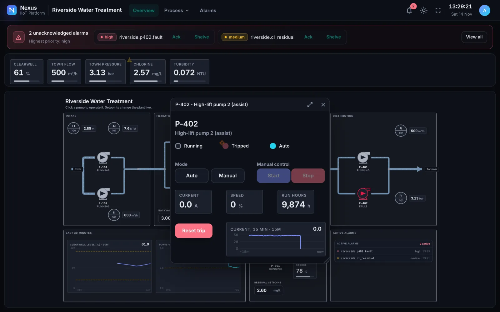

An **application** is what operators use: a line HMI, a maintenance app, an energy dashboard. It has its own views, navigation, title and colour, and runs full screen at `https://<gateway>/apps/<name>` in any browser. There are no engineering menus, and control-room screens, tablets and phones need nothing installed.

Tags, devices, alarms and history are shared by every application. A new gateway starts with one application, **Operations**, at `/apps/operations`.

## Using an application

Open `/apps` to see the applications you may open (with only one, it opens straight away), or a direct link from your engineer.



- **The header** shows the application's title, its navigation menu, the clock and your name. Your account menu has **Sign out**. In a [public application](#public-applications) you haven't signed in to, it has a **Sign in** button instead.
- **The language menu**, when the application has [translations](#translations), switches the language its screens show. Your choice is remembered.
- **The navigation menu** opens views. It is either a menu bar in the header (submenus drop down) or a side panel (submenus fold out). Some applications navigate with buttons inside the views instead.
- **The alarm ribbon** under the header shows the newest unacknowledged alarm that belongs to the screen you are on. Acknowledge it there, or open the list.
- **The bell** lists every active alarm you may see, whatever screen you are on. Open one to see its details and acknowledge it with a note.
- **The horn**, if the application sounds one, plays for new alarms until they are acknowledged or you silence it.
- **Controls** write values when you have the *Operate* permission. Buttons may ask you to confirm first. Without permission, controls are read-only.
- **Popups** open over the screen. Drag them by the title bar, and press <kbd>Esc</kbd> to close the top one.
- **Every screen has its own address**, so you can bookmark it and the browser's Back button works.
- On a phone or tablet, screens fit themselves and re-fit when you rotate; pinch or use the zoom buttons to zoom in.

When engineers publish a new version, open screens switch to it within a minute.

## Building an application

Applications are built under **Views**:

1. Pick the application in the bar above the views, or choose **New application…**.
2. Add views to it (see [Views](../views/)).
3. Open **Settings** to set it up (below).
4. **Preview** opens the draft in the operators' client (`/preview/<name>`, engineers only).
5. **Publish** makes it live.

### Settings

| Setting | Does |
|---|---|
| **Title** and **colour** | Shown in the header |
| **Home view** | Opens first. Empty opens the first navigation item |
| **Navigation** | Menu items, each opening a view with values for its parameters, so one pump faceplate can appear as *P-101* and *P-102*. Items can have submenus |
| **Where the menu shows** | A menu bar in the header, a side panel, or no menu (views navigate with buttons and **Menu** symbols of their own) |
| **Docked views** | Views docked to the top, bottom, left or right on every page: a header or footer strip, a navigation tree, an alarm summary. Each has a size, parameter values, a width below which it hides, and for side docks whether operators can fold it away |
| **Alarm ribbon** | *Show the newest unacknowledged alarm under the header*, on or off for the whole application |
| **Horn** | *Sound the horn for new alarms*, from a chosen priority up |
| **Who may open it** | Limits the application to roles. Empty means everyone who can see views; administrators always may. Applies at once, without publishing |
| **Public** | Anyone with the address may open it without signing in (administrators only). See [Public applications](#public-applications) |

The settings also have tabs for the application's **Styles**, **Session** properties and **Translations** (below).

Navigation and the home view use the application's own views. A view can still embed or pop up views from other applications.

### Alarm ribbons

The ribbon over an application's screens shows the alarms that belong to the view on screen. Each view's **Alarm ribbon** setting (in the view editor, with nothing selected) picks:

- **Alarms of this view's asset:** alarms of tags under the view's asset and the equipment below it. This is the default when the view has an asset.
- **All operator alarms:** the default for a view without an asset.
- **No ribbon.**

Alarm rules with *Show to operators* turned off, such as the gateway's own health alarms, never appear on operator screens. Operators can always reach every alarm they may see from the bell.

### Styles

**Settings → Styles** holds CSS for every view of the application: the style classes symbols take in their *CSS classes* (`.card`, `.critical`). The styles stay inside the views; they never change the header, menus or dialogs. A view's own styles come after the application's, so they win. The editor shows them on the canvas and offers the classes they define on each symbol. See [Views](../views/#styles).

### Session properties

**Settings → Session** holds values the whole session shares, the same on every view and docked panel: the line or shift picked, a mode.

- `$session.line` where a tag ID goes, `{$session.line}` in expressions, and `${session.line}` in text and tag paths.
- Bind a symbol to one (*View property* → `session.line`). An input bound to it writes it, as does *Set a view property*.
- View scripts use `nexus.session`.

They start at their defaults when the application opens in a tab, and are kept while the tab is open, through reloads. `$session.language` is always there.

### Translations

**Settings → Translations** sets the language the views are written in and the other languages operators can switch to from the header. At first an application shows the browser's language, when it has it.

1. Add the languages.
2. **Collect texts from the views** finds the captions, button texts, choices, value-map outputs, questions, messages, menu items and the title.
3. Fill in the translations, or **Export CSV** for a translator and **Import CSV** when it comes back.

A text without a translation shows as written. View scripts translate with `nexus.t(text)`.

### Messages between views

The **Send a message to other views** action sends a name and a payload to the views on the page (the page, its docked views and popups), or, with scope *session*, to every tab of the application the user has open. A view takes it with a **When a message arrives** event, its payload as `${message.<key>}` in the actions: *Set a view property* `batch` to `${message.batch}`. View scripts use `nexus.messages.on(name, fn)` and `nexus.messages.send(name, payload)`.

## Drafts, publishing and versions

What engineers change is a **draft**. Operators keep the live version until someone publishes.

- **Publish** lists what changed (new, changed and removed views, settings, and library symbols) and takes a note for the history.
- **Versions** lists every version with its note, who published it and what changed. **Make live** puts an earlier version back; the draft isn't touched.
- People without the *Engineer* permission only ever see live versions, in applications and on the Views page.

## Who sees what

- **Who may open it** limits an application to roles.
- Each view's **Who can open it** limits the view: everyone who can open the application, signed-in users only, or some roles. The navigation leaves out views a person can't open, and the gateway refuses them however they are asked for. See [Views](../views/#who-can-open-a-view).
- Navigation only lists views inside a person's [asset scope](../assets/#limiting-users-to-parts-of-the-plant).
- A symbol's **Who it's for** hides it, or greys it out, for other roles.
- Viewers can look. Operators can also write, acknowledge alarms and run scripts from buttons.

## Public applications

An application can be **public**: anyone with its address opens it without signing in. Use it for a lobby screen, a wallboard or a status page.

An administrator turns on **Public** in the application's settings, and can choose what visitors see under **Visitors see**:

- **Some assets:** visitors see the views, live values, history and alarms of those assets and the equipment below them.
- **No assets chosen:** visitors can read every tag's live value and history. Choose assets for anything that can be reached from outside the plant.

What visitors get:

- **They only look.** They can't write values, acknowledge alarms or run gateway scripts.
- **Only views without access rules.** A view set to *Signed-in users only* or to some roles is left out of their menu; if they follow a link to it, they are asked to sign in.
- **That one application.** A visitor's pass opens nothing else on the gateway: no other application, no engineering pages and no API.
- **Sign in** in the header signs them in, with whatever their account allows.

Turning **Public** off locks visitors out at once. The designer shows *Public - no sign-in needed* next to a public application's version. Public access isn't carried in projects or packages: turn it on again on the gateway they are imported into.

## Kiosk screens

For a screen that only shows values, the simplest way is a [public application](#public-applications): no account, nothing to sign in. For a screen that operators control:

1. Create an operator (or viewer) account for the screen under **Users**.
2. Sign in once on the screen's browser.
3. Start the browser full screen, for example:

   ```bash
   chromium --kiosk --noerrdialogs https://gateway:4443/apps/operations
   ```

   or use the application's full-screen button.

A screen in use stays signed in: its sign-in slides forward as it refreshes. Signing out, disabling the account under Users, or resetting its password ends it.

## Moving applications between gateways

- **Download** an application (its views and the symbols they draw) as an application package, and **Import application…** on another gateway. Imports land in the draft, ready to review and publish. See [Projects and packages](../projects-and-packages/#application-packages).
- Projects carry every application's draft. Versions stay on the gateway they were published on.
