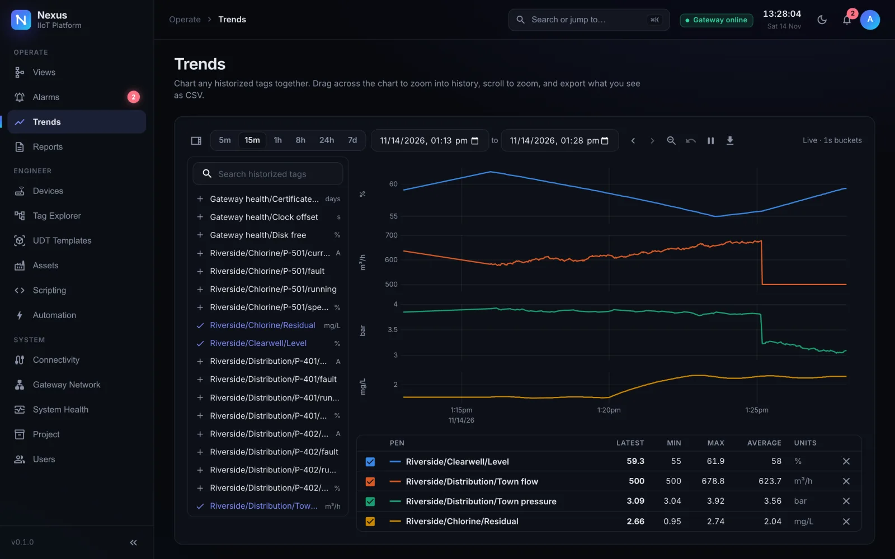

**Trends** charts any historized tags together, live or over any period. Only tags with **Historize** turned on have history (see [Tags](../tags/#history)).

## Making a chart

1. Open **Trends**.
2. Add tags from the tag browser. Each becomes a **pen** with its own colour.
3. Pick a time range: **5m**, **15m**, **1h**, **8h**, **24h** or **7d**.

### Units and axes

Pens with the same engineering units share a y-axis. Every pen draws in one plot, with each unit's axis side by side on the left, so a temperature and a flow can be compared on the same chart and each keeps its own scale. With several axes, each is edged in its first pen's colour and labelled with its unit; on/off tags get an *Off/On* axis.

The toolbar button next to **Export CSV** switches to **stacked** plots: one plot for each unit, one above the other on the same time axis. In a view, the Power chart's **Units** setting picks which it opens with.

### How each pen is drawn

In the pen table, **Drawn as** picks a line, an area, bars or steps for each pen: hourly output as bars with the rate as a line. Bars show the gateway's buckets, about one every 16 pixels, so they stay readable at any zoom.

### Comparing with earlier

**Compare with earlier** on a pen's row adds the same tag from an hour, a day, a week or four weeks earlier, drawn dashed over today's on the same time axis.

## Moving through history

- **Drag across the chart** to zoom into that period.
- **Scroll** over the chart to zoom in and out.
- **Back (undo zoom)** returns to the previous view.
- **Zoom out** widens the period.
- **Earlier** moves back in time.
- **Back to live** returns to the live, scrolling chart.

The arrow keys pan along the time axis. Move the cursor over the chart to read every pen's value at that moment: the pen table under the chart lists each pen's value at the cursor and its minimum, maximum and average over what is shown.

Long ranges are summarised on the gateway, with each interval's minimum-to-maximum range shaded, so short spikes stay visible even over weeks.

## Exporting

**Export CSV** downloads the values of every pen for the period on screen.

## Charts in views

The same chart is available as the **Power chart** symbol in views, so operators can look back without leaving their application. You choose its pens and opening period, whether units share one plot or stack, and whether operators can add pens of their own. In its **More pens**, options go in brackets after the tag: `riverside.flow (bars)`, `riverside.flow (-1d)` (a day earlier), `riverside.level (area, -7d)`, `riverside.pump.running (step)`. The smaller **Trend** symbol shows up to three tags over a fixed time span. See [Views](../views/#controls-and-data).

## History of other value types

Booleans chart as steps, on an *Off/On* axis. Text values are recorded too and appear alongside numbers in exports and reports.

## History from edge gateways

On a central gateway, edge gateways' historized tags chart like local ones. History recorded while the link was down arrives when it comes back, so there are no gaps. See [Gateway network](../gateway-network/).
