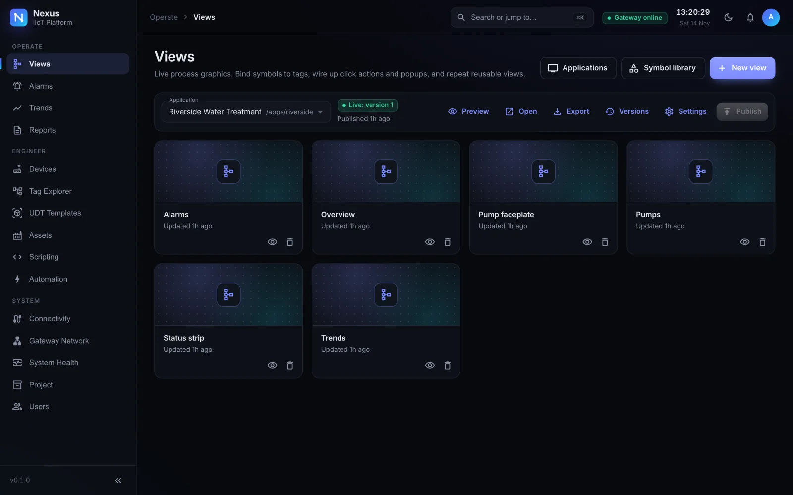
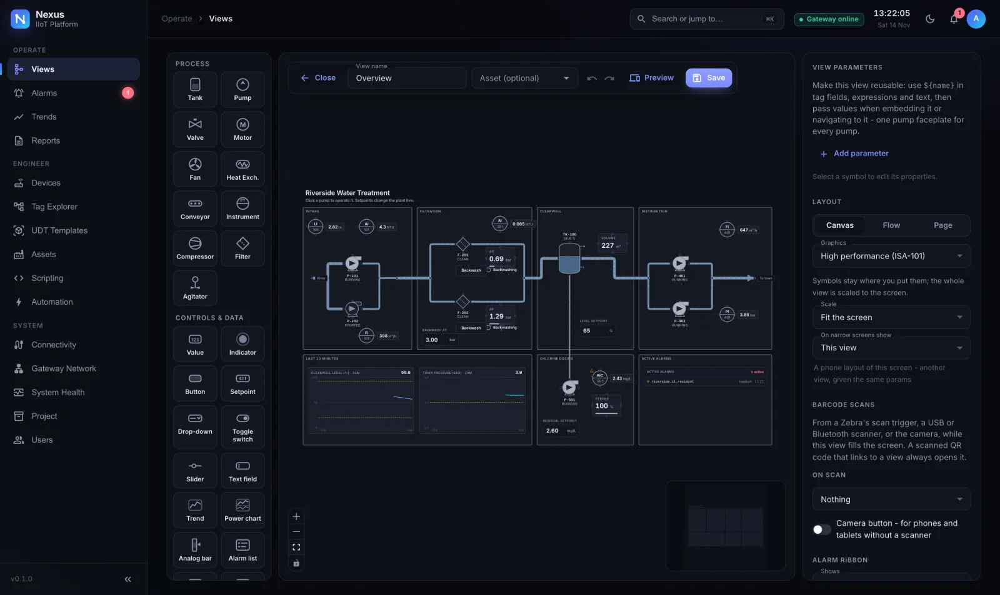

A **view** is one screen of live process graphics: tanks, pumps and valves, values, buttons, setpoints, charts and tables, bound to tags. Views belong to an [application](../applications/), which publishes them to operators.

Open **Views** to see the views of the application selected in the bar at the top. From there:

- **New view** creates one.
- **Open** shows a view live, as an operator would see it.
- The edit button opens the **view editor**.
- **Design with AI** asks the [AI assistant](../ai-assistant/) to draft one from your tags.
- **Symbol library** manages your own symbols (see [Symbol library](../symbol-library/)).

## The view editor

The editor has three parts:

- **The left column**, with three tabs:
  - **Symbols:** the palette, grouped as *Process*, *Controls & data*, *Media* and *Layout*, then your library symbols.
  - **Layers:** every symbol on the canvas, topmost first, with groups together and marks for actions, bindings, role limits and hidden symbols. Click to select, <kbd>Shift</kbd>- or <kbd>Ctrl</kbd>-click to add to the selection, double-click to zoom to it. Search finds a symbol by its caption, tag or kind.
  - **Tags:** the gateway's tag folders, or a search, to drag tags from (see [Dropping tags](#dropping-tags)).
- **The canvas** in the middle, where you place and arrange symbols.
- **The property panel** on the right, for the selected symbol. With nothing selected, it shows the view's own settings: name, asset, parameters, layout, barcode scans, alarm ribbon, who can open it, and its properties, events, script and styles.

Drag a symbol from the palette onto the canvas, then set its **tag** in the property panel. Most symbols have a main tag that drives their main property: a tank's level, a pump's running state, a value's number. Save with the save button; the view is part of the application's draft until it is published.

If someone else saved the same view after you opened it, your save is refused and the editor says who saved it and when. You can load their version or save over it.

### Dropping tags

Drag a tag from the **Tags** tab onto the canvas for a readout bound to it: an indicator for true/false, a value for a number (with its units, and a bar between its engineering limits), text otherwise. Hold <kbd>Alt</kbd> (<kbd>Option</kbd> on a Mac) while dropping for the input that writes it instead: a toggle, a setpoint or a text field. Drop a tag on a symbol and it becomes that symbol's main tag.

### Placing and editing several symbols

- While you drag a symbol, **alignment guides** show where its edges or middle line up with other symbols, and it snaps to them. Hold <kbd>Alt</kbd> to place it freely.
- With **several symbols selected**, the property panel sets the properties they share on all of them at once. A value that differs shows as *Mixed*, and bound properties keep their bindings.

### Preview

**Preview** shows the unsaved view on a phone, a tablet and a desktop. **Run it** turns the preview on: clicks, inputs, events, the view's properties and script, and popups work as they will in the application, as you. Writes go to the real tags. **Restart** opens it again from the start.

## Symbols

### Process

Tank, Pump, Valve, Motor, Fan, Heat exchanger, Conveyor, Instrument, Compressor, Filter and Agitator. Each has properties such as *running*, *fault*, *level* or *open*, a caption, and colours that follow the view's style.

### Controls and data

| Symbol | Shows or does |
|---|---|
| **Value** | A live number or text, with units and format |
| **Indicator** | A lamp for an on/off state |
| **Button** | Runs an action when clicked (see [Actions](#actions)) |
| **Setpoint** | A numeric entry that writes a tag, within a min and max |
| **Drop-down** | Picks one of several values and writes it |
| **Toggle switch** | Writes true/false |
| **Slider** | Writes a number by dragging |
| **Text field** | Writes text (and takes barcode scans) |
| **Trend** | A small live chart of up to three tags over a time span |
| **Power chart** | A full chart with several pens and history navigation, like the Trends page; operators can add pens if you allow it |
| **Check box** | Writes true/false |
| **Radio buttons** | Picks one of several values and writes it |
| **Multi-state button** | Steps through states, each with a colour: `0=Stop:error, 1=Run:success` |
| **Date & time** | Writes a date and time, as text (`2026-11-15T08:30`) or milliseconds |
| **Analog bar** | A bar for a value in its scale, with low-low, low, high and high-high marks |
| **Alarm list** | Active operator alarms, filtered by asset or tag prefix. Operators acknowledge and shelve on each row or with *Ack all*, filter by priority or unacknowledged, and open an alarm's details |
| **Alarm journal** | The alarm history of an asset or tag prefix over the last hours (operators pick 1 hour to 30 days): when each came in, who acknowledged it, and how long it lasted |
| **Tag table** | Live values of every tag in a folder |
| **Data table** | The rows of a dataset or document tag. **Columns** picks, orders and renames them; operators search and sort; it scrolls or pages. **A picked row writes to** a tag or view property, so the rest of the view can follow the row picked |
| **Bar chart** | Live values from a list of tags or a dataset's rows. Several series side by side or stacked, and a target line |
| **Pie chart** | Live values from a list of tags or a dataset's rows; past eight parts, the smallest go into *Other* |

The inputs write their tag or a [view property](#view-properties), can ask first (*Switch to {option}?*), and show just the value to someone who may not write it.

The **Power chart** draws each pen as a line, an area, bars or steps, can compare a pen with the same tag an hour, a day, a week or four weeks earlier, and shows every unit on its own axis side by side in one plot (or stacked plots). In its **More pens**, options go in brackets after the tag: `riverside.flow (bars)`, `riverside.flow (-1d)`, `riverside.level (area, -7d)`. See [Trends](../trends/).

A bar chart's bars can each have several tags joined with `+` (`L1/actual + L1/plan = Line 1`), with **Series names** such as `Actual, Plan`.

### Media

| Symbol | Shows |
|---|---|
| **Icon** | One of about seventy icons, coloured, spun or blinked by bindings |
| **Markdown** | Formatted text: headings, lists, links |
| **Image** | A picture, such as a plant photo or a logo |
| **Web page** | One of the gateway's own pages, or a site an administrator allowed under **Connectivity → Cameras & web pages** |
| **Camera** | An IP camera's live picture, relayed by the gateway so its password never reaches a browser |

### Layout

| Symbol | Use |
|---|---|
| **Text** | Labels and titles |
| **Shape** | Backgrounds and areas, with a fill, a title and an optional dashed outline |
| **Pipe** and **Pipe joint** | Connect symbols. A pipe has a size, the medium it carries, an arrow, and **Flowing** (bindable) to animate flow |
| **Menu** | The application's navigation, placed inside the view |
| **Embedded view** | Another view inside this one, with its own parameters |
| **Repeater** | One view repeated for several instances (see [Repeaters](#repeaters)) |

Every symbol has width, height, rotation, a caption and **Visible**, which can itself be bound, to hide a symbol until it matters. Operable symbols also have **Enabled**: bind it to an interlock or a view property and the symbol shows greyed out and does nothing while it's false.

## Bindings

Any property marked as bindable can be driven by a **binding** instead of a fixed value. Choose the binding kind next to the property:

| Kind | The property follows |
|---|---|
| **Tag** | A live tag value |
| **Expression** | A calculation over tags, using the [expression language](../expressions/) |
| **History** | An aggregate of a tag's history over the last N minutes: average, minimum, maximum or last |
| **Parameter** | One of the view's parameters |
| **View property** | One of the [view's properties](#view-properties), or a session value (`session.line`) |
| **Symbol** | Another symbol's property, as it shows |

### Transforms

A binding can pass its value through a **transform** before the property gets it:

- **Value map:** rows that turn a value into what the property needs. `0` → *Stopped*, `1` → *Running*, `2` → *Fault*, or a level range → a colour. Each row matches an exact value (*equals*) or a numeric range. The first matching row wins; with no match the fallback applies, otherwise the value passes through.
- **Format:** a number format and suffix: `#,##0.0` and ` bar`.
- **Expression:** an expression where `{value}` is the bound value, and other tags and functions may join it: `if({value} > 80, "#d33", "#2a2")`.

## Actions

Buttons and most symbols can run an **action** when clicked:

| Action | Does |
|---|---|
| **Write a value** | Writes a fixed value to the symbol's tag or another tag |
| **Toggle** | Flips a boolean tag |
| **Open a view** | Navigates to another view, with parameter values |
| **Open a popup** | Opens a view in a floating window |
| **Close popup** | Closes the popup the symbol is in |
| **Set a view property** | Sets a [view property](#view-properties) to a value, or flips a true/false one |
| **Send a message to other views** | Sends a named message with a payload to the other views on the page, or to every tab of the application (see [Applications](../applications/#messages-between-views)) |
| **Run a gateway script** | Calls a message handler script with a payload (see [Scripting](../scripting/#message-handlers)) |
| **Call a view script function** | Calls a function of the [view's script](#the-views-script) |
| **Run JavaScript** | Runs a few lines of JavaScript in the view's sandbox |
| **Show a message** | Shows the operator a message |

Write, toggle, navigate and script actions can **Ask first**: a confirmation such as *Start pump ${pump}?* before the action runs. Writes are checked against the operator's role and the tag's write roles. Operators without permission see controls as read-only.

A message handler can answer the operator: return text to show it, or `{ message, severity, navigate, popup }` to show a message and open a view.

## Popups

**Open a popup** shows a view in a floating window over the current one: a pump faceplate over the overview. Settings:

- **View** and its parameter values.
- **Title**, **Width** and **Height**.
- **Position:** a window in the middle, or a full-height panel along the left or right side.
- **Modal:** dims and blocks the view behind it until closed. With *close on outside click*, a click outside closes it.
- **Resizable**, and whether it shows its title bar.

Operators can drag popups, and <kbd>Esc</kbd> closes the top one.

## Parameters

A view can declare **parameters**, each with a default, and use them as `${name}` in any text field: tag IDs, captions, expressions, action values. One faceplate view then serves every pump:

- A tank symbol bound to `${pump}.level`.
- A navigation item or button opens the view with `pump = plant.p101`.

Parameters can come from navigation items, popup and navigate actions, embedded views, repeaters, scan actions and the view's own URL (`/apps/operations/12?pump=plant.p101`).

## Repeaters

A **Repeater** shows one view many times, in rows, a column or a wrapping grid:

- **A list I type in:** each item with its parameter values.
- **One per subfolder of a tag folder:** for example one card per pump folder under `Plant/Pumps`. Each subfolder's shared tag ID prefix (`plant.pumps.p101`) is passed as the parameter you name, and optionally the folder name too. A new pump folder then appears on screen without editing the view.

Set the item width and height, and the gap between items.

## View properties

A view can hold values of its own while it is on screen: the pump picked in a drop-down, whether a details panel shows, a count. Add them under view settings → **Edit properties, events, script & styles → Properties**: a name, a type (text, number or true/false) and what it starts as. Each view on screen has its own, starting at their defaults every time it opens.

- **Bind to one:** a property's binding → *View property*. An input whose value is bound to a view property writes the property instead of a tag, and everything else bound to it follows.
- **Set one** with the *Set a view property* action.
- **Anywhere a tag ID goes,** a view property is `$name`: a symbol's main tag, a tag binding, a write action, a *When a tag changes* event.
- **In expressions** it is `{$name}`. `{$user.name}`, `{$user.role}` and `{$user.email}` are the signed-in user.
- **In text and tag paths** it is `${name}`, like a parameter: `${pump}.running` follows the pump picked.

Values the whole session shares, on every view of the application, are [session properties](../applications/#session-properties).

## Events

Views and their symbols can act on their own as well as on clicks. Events run in applications and the viewer, not in the editor, and always as the operator viewing the view: their permissions and each tag's write roles apply.

**Symbol events** (a symbol's properties → *Events*):

- **On click:** a list of actions, run in order.
- **Double-click.**
- **The pointer coming over it or leaving it** (mouse only).
- **Its value changing.**

**View events** (view settings → *Edit properties, events, script & styles*):

- **When the view opens or closes.**
- **On a timer,** every so many seconds.
- **When a tag changes:** any new value, or when it becomes true or false. `$name` watches a view property.
- **When a message arrives** from another view, with its payload as `${message.<key>}` in the actions.
- **Keyboard shortcuts,** such as <kbd>F2</kbd> or <kbd>Ctrl</kbd> + <kbd>S</kbd>. They don't fire while someone is typing in a field.

Views shown in their own right run their events: an application's views and docked panels, popups and the viewer. Views embedded in another or repeated don't.

## The view's script

A view can have a **script**: JavaScript that runs while the view is on screen. It runs in a sandbox with no access to the page, the user's sign-in or the network, only to a `nexus` object:

| | |
|---|---|
| `nexus.tags` | `watch(tagId, fn)`, `value`, `read` and `write(tagId, value)` |
| `nexus.props` | `get`, `set`, `watch` and `all` for the view's properties |
| `nexus.session` | The application's session properties |
| `nexus.messages` | `on(name, fn)` and `send(name, payload)` |
| `navigate`, `openPopup`, `closePopup` | Move between views |
| `runScript(handler, payload)` | Call a gateway message handler |
| `notify(message, severity)` | Show the operator a message |
| `on('open' \| 'close', fn)`, `onKey('F2', fn)`, `every(seconds, fn)`, `log` | React and record |
| `params`, `view`, `user`, `t(text)` | Where it is, who is looking, and translations |

Functions the script defines are what *Call a view script function* actions call. Script errors show on screen to people with the *Engineer* permission, and always in the browser console.

## Styles

- **The view's CSS** (view settings → *Edit properties, events, script & styles → Styles*) applies inside that view only. `:root` is the view itself, `.class` matches symbols given that class (a symbol's properties → *Styles → CSS classes*), `[data-symbol-id="pump-1"]` matches one symbol, and `.nx-symbol` every symbol.
- **A symbol can have CSS of its own:** declarations, and nested rules such as `&:hover { … }`.
- **The application's styles** apply to every view of it (see [Applications](../applications/#styles)). A view's own styles come after, so they win.
- The theme's colours are variables (`var(--nx-text)`, `--nx-primary`, `--nx-error`, …), so styles follow light and dark mode.

Every rule stays inside the view: it can't load anything from elsewhere or cover the rest of the application.

## Who sees what

### Who a symbol is for

A symbol's properties → **Who it's for** limits it to roles. Everyone else doesn't see it, or sees it greyed out with its clicks and inputs doing nothing. It shapes the screen only: what someone may write is still decided by each tag's write roles.

### Who can open a view

With nothing selected, **Who can open it** decides who may open the view in its application:

| Open to | Who |
|---|---|
| **Everyone who can open the application** (the default) | Everyone who may open the application, including visitors to a [public application](../applications/#public-applications) |
| **Signed-in users only** | Anyone signed in, but not visitors |
| **Only these roles** | People with one of the roles you pick. Administrators always may |

It's published with the view. The navigation leaves out views a person can't open, and the gateway refuses them however they are asked for: a link, a popup, an embedded view or the API. A person who follows a link to one sees that they don't have access; a visitor is offered to sign in. Engineers still edit every view.

## Layout and screen sizes

The view's **Layout** settings decide how it fills the screen:

| Mode | Behaviour |
|---|---|
| **Canvas** | Symbols stay where you placed them, and the whole view is scaled: **Fit the screen**, **Fit the width (scrolls down)** or **Actual size (scrolls)**. Best for process graphics and P&IDs. |
| **Flow** | Symbols are laid out like a web page, in rows or a column that wraps, so the screen reflows on a tablet or phone. |
| **Page** | A layout of rows, columns, grids, cards and tabs holding symbols and process canvases. Best for dashboards and forms. |

For phones:

- **On narrow screens show** another view, given the same parameters: a phone layout of the same screen. Set the width it applies below (phones are under 600 px, tablets under 1000).
- **Hide on screens narrower than** on a symbol leaves out detail a phone doesn't need.

### Style

| Style | Look |
|---|---|
| **High performance** (the default) | Grey equipment, with colour only for what is abnormal, following ISA-101 |
| **Classic** | Colourful equipment |

Views follow the light or dark theme of the screen they are on.

## Arranging symbols

Select several symbols with a drag or <kbd>Shift</kbd>-click, then use the arrange bar to align them (left, centre, right, top, middle, bottom), space them evenly across or down, group them, and bring them to the front or send them to the back.

### Keyboard shortcuts

| Keys | Does |
|---|---|
| <kbd>Ctrl</kbd> + <kbd>Z</kbd> | Undo |
| <kbd>Ctrl</kbd> + <kbd>Shift</kbd> + <kbd>Z</kbd> or <kbd>Ctrl</kbd> + <kbd>Y</kbd> | Redo |
| <kbd>Ctrl</kbd> + <kbd>C</kbd> / <kbd>X</kbd> / <kbd>V</kbd> | Copy, cut, paste (also between views) |
| <kbd>Ctrl</kbd> + <kbd>D</kbd> | Duplicate |
| <kbd>Ctrl</kbd> + <kbd>G</kbd> | Group |
| <kbd>Ctrl</kbd> + <kbd>Shift</kbd> + <kbd>G</kbd> | Ungroup |
| <kbd>Backspace</kbd> | Delete the selection (or **Delete** in the arrange bar) |

On a Mac, use <kbd>⌘</kbd> instead of <kbd>Ctrl</kbd>.

## Alarm ribbon and barcode scans

With nothing selected, the property panel also has (besides **Who can open it**, above):

- **Alarm ribbon:** what the ribbon over this view shows in its application: the alarms of this view's asset (the default when the view has one), all operator alarms, or no ribbon. See [Applications](../applications/#alarm-ribbons).
- **Barcode scans:** what a barcode or QR scan does while this view fills the screen. See [Barcode and QR scanning](../barcode-scanning/).

## Trying a view

**Open** (or **Open in viewer** from the editor) shows the view live with real values, so you can try buttons, popups and scans. Writes are real, so take care on a running plant. **QR code** makes a printable label that opens this view on a phone or scanner.

## Moving views between gateways

Views travel inside their application: export the application as a package, or the whole configuration as a project. See [Projects and packages](../projects-and-packages/).
